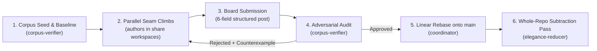

# Swarm Hillclimb Protocol: Efficacy and Elegance Convergence

## 1. Purpose and Baseline

`mesh-wick` (`wick`) is a local, zero-telemetry web acquisition and search CLI for AI agents. Its objective is to acquire public web documents over browser-grade network and offscreen-rendering transports and emit compact, structurally faithful Markdown (or exact raw bytes) with deterministic machine-readable metadata and exit codes (`0..=5`).

Current repository baseline on `main`:

- `src/`: `6,233` lines of Rust across `context`, `crawl`, `extract`, `fetch`, `policy`, `search`, and `transport`.
- `cef/`: `1,510` lines of C and Objective-C implementing the `v4-meta` offscreen Chromium renderer.
- `tests/`: `1,580` lines across `28` crate-level and unit tests.
- Prerequisite specification: `docs/01-transport-daemon-and-batch-fetch.md` (Milestone 1 landed; Milestone 2 pending).

Multi-agent hillclimbing on a compact systems codebase fails when optimization lacks a deterministic offline objective, when parallel efficacy patches accrete special-case branches without structural compression, or when concurrent workers collide on `main`, build locks, or Unix domain sockets. This specification defines the evaluation harness, Pareto acceptance rules, seam-partitioned swarm topology, generation ratchet, and dependency-ordered waves used to climb `mesh-wick` simultaneously toward higher efficacy and stricter elegance.

---

## 2. Deterministic Evaluation Architecture

All hillclimbing decisions are governed by deterministic, zero-network local commands. Live internet origins are never queried inside the optimization loop; live runs occur only in an out-of-loop canary harvest to capture new static fixtures.

### 2.1 Offline Corpus Layout (`tests/corpus/`)

Each fixture under `tests/corpus/<fixture_identifier>/` consists of:

1. `input.html` (or `input.bin` for binary payload guards): raw response bytes as received from an origin or `wick-renderer`.
2. `metadata.json`:
   - `url`: requested URL string.
   - `final_url`: post-redirect URL string.
   - `status_code`: HTTP status (`u16`).
   - `content_type`: optional `Content-Type` header string.
   - `extract_mode`: `"clean"` | `"article"` | `"full"`.
3. `annotations.json`:
   - `expected_classification`: `"ok"` | `"javascript_shell"` | `"blocked"` | `"challenge"` | `"http_error"` | `"unsupported_content_type"`.
   - `must_keep_substrings`: ordered non-trivial prose, table cell, and heading substrings that must appear in extracted output.
   - `must_keep_code_blocks`: expected `{ "language": Option<String>, "snippet": String }` entries verifying fence preservation and gutter cleanup.
   - `must_keep_links`: expected resolved destination URLs verifying `<base href>`, relative path resolution, and tracking-parameter removal.
   - `must_drop_substrings`: navigation chrome, cookie-consent copy, copy-code button labels, heading permalink glyphs, and hydration JSON strings that must not appear in extracted output.

The corpus spans representative technical documentation (Rustdoc, MDN, GitHub, Nextra, Mintlify, Docusaurus, ReadTheDocs), content aggregators (`old.reddit.com`, Hacker News), encyclopedic and academic HTML (Wikipedia, ArXiv HTML), client-rendered shells, Cloudflare/DataDome challenge interstitials, HTTP-200 soft-404 and login walls, malformed pipe tables, and ISO-8859-1 / Windows-1252 documents.

### 2.2 Four-Axis Scorecard (`CorpusScorecard`)

Every candidate commit produces a deterministic JSON scorecard across four axes:

1. **Gate 0 — Soundness Invariants (`soundness_gate: bool`)**
   - `cargo test` and `cargo test --features cronet` pass completely.
   - `cargo clippy --all-targets --features cronet -- -D warnings` emits zero warnings.
   - Native C/Objective-C headers in `cef/` compile with `-Wall -Wextra -Werror`.
   - Structural invariants hold over boundary inputs:
     - `truncate_markdown(input, max_bytes)` satisfies `output.len() <= max_bytes`, valid UTF-8, and zero unclosed fenced code blocks across all byte budgets `0..=input.len()`.
     - `strip_tracking_parameters` leaves non-tracking query strings (including signed S3/CloudFront URLs) byte-for-byte unchanged.
     - Two-part binary wire framing (`JSON header\n + raw bytes`) rejects malformed headers, oversized payloads, and truncated streams cleanly without panic or unbounded allocation.

2. **Axis 1 — Extraction Efficacy (`ExtractionScorecard`)**
   - `classification_exactness`: exact match fraction across all corpus fixtures (`1.0` required on existing fixtures).
   - `must_keep_recall`: fraction of all `must_keep_substrings`, `must_keep_code_blocks`, and `must_keep_links` present in extracted Markdown.
   - `noise_suppression`: fraction of all `must_drop_substrings` absent from extracted Markdown.
   - `signal_density`:
     $$\text{signal\_density} = \frac{\sum \text{matched\_must\_keep\_bytes}}{\max(1,\ \sum \text{output\_bytes})}$$
     Pairing `signal_density` with `must_keep_recall` prevents gaming compactness by deleting body prose.
   - `extraction_throughput_mib_per_sec`: aggregate corpus input bytes divided by extraction wall time (tracked for regression screening, gated at `<= 10%` variance).

3. **Axis 2 — Transport and Pipeline Efficacy (`TransportScorecard`)**
   - Evaluated against deterministic `127.0.0.1:0` loopback HTTP servers and deterministic `wick-renderer` protocol harnesses:
   - `warm_http_p95_ms` and `batch_16_wall_ms`: latency through `daemon.sock` with pooled `TransportClient`.
   - `cef_settle_overhead_ms`: elapsed delay between DOM readiness (or `wait_for_selector` match) and response frame emission in `cef/protocol.h` + `cef/renderer_core.h`.
   - `resource_hygiene`: zero leaked child processes, zero orphaned socket locks, and zero lost `SiteCache` entries under 8-process concurrent writes.

4. **Axis 3 — Architectural Elegance (`EleganceScorecard`)**
   - `source_line_count`: total lines across `src/**/*.rs` and `cef/*.{c,h,m}` formatted via `rustfmt` / standard C formatting (preventing horizontal line-golfing).
   - `unsafe_block_count`: count of `unsafe` blocks across `src/`.
   - `dom_traversal_complexity`: verified upper bound on tree walks per HTML extraction (`1` `scraper` parse + `1` `O(N)` bottom-up metric pass + `1` `htmd` conversion).
   - `untyped_error_matches`: count of cross-module string-prefix/substring error classifications (target: `0`).

### 2.3 Lexicographic Pareto Acceptance Gate

A candidate commit is compared against the current `main` baseline scorecard:

- **Efficacy Commit Acceptance**:
  1. `soundness_gate == true`.
  2. `classification_exactness >= baseline.classification_exactness` and `must_keep_recall >= baseline.must_keep_recall`.
  3. At least one primary efficacy metric (`must_keep_recall`, `noise_suppression`, `signal_density`, `cef_settle_overhead_ms`, or `batch_16_wall_ms`) strictly improves without regressing any sibling metric.
  4. **Complexity Tax**: net growth in `source_line_count` must remain proportional to efficacy gain; any heuristic adding `> 120` net lines for a single-fixture improvement is rejected in favor of a structural abstraction.
- **Subtraction Commit Acceptance (Elegance Ratchet)**:
  1. `soundness_gate == true`.
  2. Every `ExtractionScorecard` and `TransportScorecard` metric is `>=` baseline (zero efficacy loss).
  3. At least one `EleganceScorecard` cost (`source_line_count`, `unsafe_block_count`, `untyped_error_matches`, or asymptotic pass count) strictly decreases while `rustfmt` formatting remains standard.

---

## 3. Swarm Roster, Seam Ownership, and Hermetic Isolation

### 3.1 Five-Member Roster

For a ~7.7k-line Rust + C repository on linear `main`, five roles prevent rebase gridlock while preserving adversarial separation:

| Roster Name | Workspace | Owned Paths | Forbidden Paths | Primary Responsibility |
| :--- | :--- | :--- | :--- | :--- |
| `coordinator` | `inherit` | `main` branch, `docs/` | Mid-wave edits in `src/`, `cef/` | Schedules waves, arbitrates cross-seam signatures, rebases approved commits linearly onto `main`, pushes `main`. |
| `corpus-verifier` | `share` | `tests/corpus/`, `tests/` | `src/`, `cef/` | Curates corpus snapshots and ground-truth annotations, authors adversarial counterexample tests, audits candidate commits against the Pareto gate. |
| `transport-author` | `share` | `src/transport/`, `src/daemon/`, `cef/`, `build.rs` | `tests/corpus/` annotations | Implements unified `daemon.sock` transport RPC, Cronet/CEF slot lifecycle, CEF readiness poller precision, and typed wire error codes. |
| `extraction-author` | `share` | `src/extract/`, `src/policy/` | `tests/corpus/` annotations | Implements `O(N)` DOM content-root scoring, code/table/image fidelity, boilerplate pruning, response classification, and `flock`-serialized `SiteCache`. |
| `elegance-reducer` | `share` | `src/main.rs`, `src/fetch.rs`, `src/crawl.rs`, `src/search.rs`, `src/context.rs` (wave); whole repo (subtraction pass) | `tests/corpus/` annotations | Implements CLI/batch/search/crawl composition during feature waves; executes mandatory whole-repo Subtraction Passes closing every wave. |

- **Rationale for Generator–Verifier Separation**: forbidding authors from modifying `tests/corpus/` annotations makes benchmark tampering structurally impossible; forbidding `corpus-verifier` from editing `src/` keeps red-team incentives aligned with uncovering edge cases.

### 3.2 Shared Seam Protocol

Cross-seam struct or signature changes (`RuntimeContext` in `src/context.rs`, `FetchError` in `src/fetch.rs`, `HttpResponse` in `src/transport/mod.rs`) follow a strict header-first rule:

1. At the start of a wave, if an interface signature must change, `coordinator` (or one designated lead author before parallel fan-out) lands the minimal type/trait signature commit on `main` first.
2. Parallel workers then fork/rebase onto that signature commit so their implementations compile without conflicting edits in `src/context.rs` or `src/fetch.rs`.

### 3.3 Hermetic Build, Socket, and Challenge Rules

1. **Per-Worker Build Isolation**: each `share` workspace sets `CARGO_TARGET_DIR=<workspace_root>/target` (or a worker-specific path) so parallel `cargo test --features cronet` invocations never block on a single Cargo build-directory file lock.
2. **Short-Path Hermetic `state_dir`**: macOS `std::env::temp_dir()` paths (`/var/folders/...`) can exceed 60 bytes, approaching the 104-byte Unix domain socket `sun_path` limit enforced in `cef_daemon.rs`. All daemon and session tests must allocate short state directories under `/tmp/wick-test-<pid>-<seq>` (`0o700`) and remove them on teardown, never touching `~/.mesh-wick`.
3. **Explicit Daemon Binary Resolution in Tests**: integration test binaries must resolve `env!("CARGO_BIN_EXE_wick")` (with an explicit override on `RuntimeConfig` or `WICK_DAEMON_EXE`) rather than `std::env::current_exe()` when auto-spawning `wick daemon run`, because `current_exe()` inside a test harness points to the test runner binary rather than `wick`.
4. **Strict Anti-Bot and Challenge Boundary**: workers never implement CAPTCHA solving, synthetic challenge clicking, or anti-bot evasion scripts. When an origin returns an active bot challenge (`403`/`503` or HTTP-200 interstitial), correct behavior is immediate, deterministic classification into `FetchError::Challenge` (exit code `2`) without burning retry timeouts.

---

## 4. Generation Ratchet Protocol

Each dependency wave executes a six-step ratchet cycle:



### 4.1 Inner Author Loop and Two-Strike Reset

Inside its `share` workspace, each author runs tight single-hypothesis iterations:

1. Formulate one falsifiable hypothesis targeting a measured gap on the scorecard.
2. Implement the minimal change and run `rustfmt`, `clippy`, `cargo test --features cronet`, and the corpus scorecard.
3. **Two-Strike Reset Rule**: if a hypothesis fails verification or breaks sibling fixtures twice, run `git reset --hard main` and reformulate from scratch rather than stacking corrective patches onto a flawed mechanism.

### 4.2 Swarm Board Message Contract

To keep shared board context compact, every candidate handoff uses an exact six-field record:

```text
WAVE_SEAM: W2 / cef-readiness
COMMIT: <commit-sha> (<workspace-name>)
HYPOTHESIS: <single sentence>
SCORECARD_DELTA: recall +0.000 | noise +0.000 | density +0.000 | cef_overhead 8050ms -> 140ms | sloc -12
VERIFICATION: cargo test --features cronet (<N> passed); clippy clean
TOUCHED_FILES: cef/protocol.h, src/transport/cef.rs, tests/cef_protocol_tests.rs
```

### 4.3 Adversarial Audit and Linear Landing

1. `corpus-verifier` inspects `COMMIT`, verifies `TOUCHED_FILES` respects seam ownership and leaves `tests/corpus/` annotations untouched, writes at least one adversarial edge-case assertion probing false-positive risk, and replies `APPROVE <sha>` or `REJECT <sha>: <counterexample>`.
2. `coordinator` fetches approved commits in dependency order, rebases each linearly onto `main` (`git rebase`, zero merge commits), re-runs Gate 0 + scorecard, and fast-forwards `main`.
3. Once all wave authors land, `elegance-reducer` rebases onto `main` and executes a **Subtraction Pass**, deleting redundant helpers, collapsing multi-pass loops, tightening module visibility (`pub` -> `pub(crate)` -> private), and landing a pure complexity-reduction commit before the next wave opens.

---

## 5. Dependency-Ordered Hillclimb Waves

### Wave 0 — Deterministic Corpus and Scorecard Harness
- **Owners**: `corpus-verifier` (corpus + harness), `elegance-reducer` (scorecard CLI/test runner integration).
- **Deliverables**:
  - `tests/corpus/` seeded with initial HTML/binary fixtures and `annotations.json` ground truth across documentation, aggregator, SPA-shell, challenge-interstitial, soft-404, table/code, and Latin-1 categories.
  - `tests/corpus_evaluation.rs` computing `CorpusScorecard` deterministically and asserting Gate 0 property invariants (`truncate_markdown` fuzz sweeps, signed URL preservation, binary frame boundary tests).
  - Baseline `CorpusScorecard` recorded on `main`.

### Wave 1 — Unified Warm Transport Daemon and Composable Pipelines
- **Owners**: `transport-author` (`src/daemon/`, `src/transport/`, `build.rs`), `extraction-author` (`SiteCache` `flock`), `elegance-reducer` (`fetch` batching, `search` flags, `crawl`/`map` concurrency).
- **Deliverables**:
  - Complete `docs/01-transport-daemon-and-batch-fetch.md` Milestone 2:
    - Concurrent `src/daemon/` (`Ping`, `Shutdown`, `HttpGet`, `CefRender`) over two-part frames (`daemon.sock`), proxy-partitioned `(TransportClient, CefRenderer)` slots (LRU cap 4), client-disconnect cancellation, `WICK_BUILD_ID` mismatch auto-restart, and `CARGO_BIN_EXE_wick`-safe daemon spawning.
    - Advisory `flock` around read-merge-write in `src/policy/cache.rs` (`site-cache.lock`).
    - Pooled Brave `reqwest::Client` on `RuntimeContext`; `wick search` `--urls-only`, `--freshness`, `--site`, and `--extra-snippets`.
    - Multi-URL and stdin (`-`) batch `wick fetch` with `--concurrency`, per-host `Semaphore(2)`, `--jsonl`, and exit code `4` on partial failure.
    - Bounded concurrent `crawl` (replacing sequential `500ms` sleeps in `src/crawl.rs`) and recursive `<sitemapindex>` resolution in `map`.

### Wave 2 — CEF Readiness Precision and Typed Wire Errors
- **Owners**: `transport-author` (`cef/`, `src/transport/`), `corpus-verifier` (mock/OSR timing and error-code harnesses), `elegance-reducer` (subtraction pass).
- **Deliverables**:
  - **Fix `len > 500` timeout trap in `cef/protocol.h`**: currently `var stableHit=!isCF&&len>500&&stable>=1000&&hit;` forces any page with `<= 500` characters of `innerText` (concise posts, short documentation pages, minimal SPAs) to stall until `js_cap` (`8000ms`, or `20000ms` with selector) expires, and imposes a `1300ms` floor on all pages. Replace with:
    - Immediate completion as soon as explicit `wait_for_selector` matches on a non-challenge document.
    - `MutationObserver` + `requestAnimationFrame` quiet-window settle (`~150–250ms` of zero DOM subtree mutations after `load` when `body` is non-empty and non-challenge) for selector-less renders, regardless of whether `innerText.length` is above or below `500`.
  - **Structured Error Codes across Native/IPC Seams**: add explicit machine-readable `error_code` fields (`"timeout"`, `"load_error"`, `"invalid_selector"`, `"response_too_large"`, `"canceled"`, `"protocol_mismatch"`) to `wick-renderer` `v4-meta` headers, `daemon.sock` responses, and `TransportClient` errors, deleting string-prefix matching in `src/transport/cef.rs` and `src/transport/cronet.rs`.

### Wave 3 — `O(N)` DOM Content Scoring and Technical Documentation Fidelity
- **Owners**: `extraction-author` (`src/extract/`, `src/policy/`), `corpus-verifier` (adversarial HTML counterexamples), `elegance-reducer` (subtraction pass).
- **Deliverables**:
  - **Single-Pass `O(N)` Bottom-Up DOM Metrics (`src/extract/dom.rs`)**: replace repeated `O(N^2)` subtree walks in `select_root_id` and `text_metrics` with one post-order traversal over `ego_tree` computing `NodeMetrics { prose_bytes, link_text_bytes, code_bytes, heading_count, form_count }` per node. Use these metrics both for `Article` root selection and to strip high-link-density navigation chrome in `Clean` mode.
  - **`<header>` Navigation Chrome Surgery**: instead of retaining an entire site-wide `<header>` whenever it contains `<h1>` (`src/extract/dom.rs`), detach `<nav>` / link-cluster siblings inside `<header>` while preserving the `<h1>` heading subtree.
  - **Technical Documentation Fidelity (`src/extract/dom.rs`, `src/extract/markdown.rs`)**:
    - Detect 2-column line-number gutter `<table>` layouts (`td.hljs-ln-numbers` / `td.blob-num` / monotonic integer-only first column paired with `<pre>`/`<code>` second column) and unwrap them into clean fenced code blocks with preserved `language-*` info strings, verified against counterexample numeric data tables.
    - Strip injected `Copy` / `Copied` button elements inside `<pre>` blocks and self-referential heading anchor permalinks (`<a href="#...">` containing only `#`, `§`, or zero-width/icon glyphs).
    - Resolve `<picture><source srcset>` and `img[data-src]` / `srcset` primary candidates when `img[src]` is missing or a `data:` placeholder.
  - **HTTP-200 Soft-Block and Interstitial Classification (`src/policy/classify.rs`)**: expand `ResponseClassification` accuracy on HTTP-200 login walls, cookie walls, and noscript/hydration shells without false positives on short technical pages.

### Wave 4 — Out-of-Loop Canary Harvest and Final Compression
- **Owners**: `coordinator` (live canary execution), `corpus-verifier` (snapshot anonymization and annotation), `elegance-reducer` (final whole-repo subtraction pass).
- **Deliverables**:
  - Execute a one-shot live canary (`wick search` + `wick fetch`) across 20 representative developer documentation, repository, forum, and SPA URLs strictly to harvest any unhandled DOM patterns into static `tests/corpus/` fixtures.
  - Climb any newly exposed fixture gaps via one Wave 3 iteration.
  - Run a final whole-repo Subtraction Pass auditing dead symbols, public API surface (`src/lib.rs`), memory allocations on the hot extraction path, and documentation parity in `README.md`, then push linear `main`.

---

## 6. Ready-to-Use `/swarm` Worker Briefs

When launching `/swarm`, `coordinator` spawns the four workers below using `workspace: "share"`.

### 6.1 `corpus-verifier` Brief
> You own `tests/corpus/` and adversarial test verification in `tests/`. You are forbidden from editing `src/` or `cef/`. Read `docs/02-swarm-hillclimb-protocol.md` and `docs/01-transport-daemon-and-batch-fetch.md`.
> 1. In Wave 0, build `tests/corpus_evaluation.rs` and seed `tests/corpus/` with deterministic HTML/binary fixtures + `annotations.json` covering technical docs, code gutter tables, `<header>` with `<h1>`, SPA shells, challenge interstitials, soft-404s, signed URLs, and Latin-1 HTML, plus Gate 0 property tests (`truncate_markdown` byte ceiling + fence closure, two-part frame truncation).
> 2. In Waves 1–4, audit every candidate commit posted by authors: verify seam boundaries and untouched corpus annotations, add at least one adversarial counterexample test targeting false-positive edge cases, run `CARGO_TARGET_DIR=$PWD/target-verifier cargo test --features cronet`, and post `APPROVE <sha>` or `REJECT <sha>: <counterexample>`.

### 6.2 `transport-author` Brief
> You own `src/transport/`, `src/daemon/`, `cef/`, and `build.rs` (`workspace: "share"`). Never edit `tests/corpus/` annotations and never touch `~/.mesh-wick` (always use `/tmp/wick-test-<pid>-<seq>` in tests and `CARGO_TARGET_DIR=$PWD/target-transport`). Read `docs/01-transport-daemon-and-batch-fetch.md` and `docs/02-swarm-hillclimb-protocol.md`.
> 1. Wave 1: replace `src/transport/cef_daemon.rs` with concurrent `src/daemon/` (`Ping`, `Shutdown`, `HttpGet`, `CefRender` over two-part binary frames), proxy-partitioned `(TransportClient, CefRenderer)` slots, client-disconnect cancellation, `WICK_BUILD_ID` mismatch restart, and explicit daemon binary path resolution safe under `cargo test`.
> 2. Wave 2: fix the `len > 500` timeout trap in `cef/protocol.h` using immediate `wait_for_selector` completion and `MutationObserver` quiet-window settle; replace untyped error strings across `cef/protocol.h`, `src/transport/cef.rs`, and `src/transport/cronet.rs` with structured error codes. Post 6-field board handoffs per commit.

### 6.3 `extraction-author` Brief
> You own `src/extract/` and `src/policy/` (`workspace: "share"`). Never edit `tests/corpus/` annotations; use `CARGO_TARGET_DIR=$PWD/target-extract`. Read `docs/01-transport-daemon-and-batch-fetch.md` and `docs/02-swarm-hillclimb-protocol.md`.
> 1. Wave 1: add advisory `flock` (`site-cache.lock`) around read-merge-write in `src/policy/cache.rs` with multi-process contention tests.
> 2. Wave 3: replace `O(N^2)` subtree walks in `src/extract/dom.rs` with a single-pass `O(N)` bottom-up `NodeMetrics` computation; prune `<header>` nav siblings without dropping nested `<h1>`; unwrap 2-column line-number code tables into fenced code blocks with `language-*` tags; strip `<pre>` copy buttons and heading `#`/`§` permalink anchors; resolve `<picture>`/`srcset`/`data-src` images; tighten HTTP-200 soft-block classification in `src/policy/classify.rs`. Post 6-field board handoffs with `CorpusScorecard` deltas.

### 6.4 `elegance-reducer` Brief
> You own `src/main.rs`, `src/fetch.rs`, `src/crawl.rs`, `src/search.rs`, and `src/context.rs` during feature waves, and whole-repo Subtraction Passes at the close of every wave (`workspace: "share"`, `CARGO_TARGET_DIR=$PWD/target-elegance`). Never edit `tests/corpus/` annotations. Read `docs/01-transport-daemon-and-batch-fetch.md` and `docs/02-swarm-hillclimb-protocol.md`.
> 1. Wave 1: pool the Brave `reqwest::Client` on `RuntimeContext`; implement `wick search` `--urls-only`, `--freshness`, `--site`, `--extra-snippets`; implement multi-URL and stdin (`-`) batch `wick fetch` (`--concurrency`, per-host `Semaphore(2)`, `--jsonl`, exit code `4`); upgrade `src/crawl.rs` to bounded concurrency and recursive `<sitemapindex>` discovery.
> 2. End of every wave: rebase onto `main` and land a pure Subtraction Commit (`soundness_gate == true`, zero regression on any `ExtractionScorecard` or `TransportScorecard` metric, strict reduction in `source_line_count`, `unsafe_block_count`, duplicate helpers, or visibility surface).
