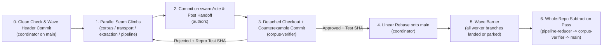

# Swarm Convergence Protocol: Efficacy and Elegance Specification

> [!NOTE]
> Historical milestone specification written under the pre-rename `mesh-wick` (`wick`) name. Core swarm convergence and Subtraction Pass principles remain active (with `pleb` / `pleb-fixture` conventions defined in [AGENTS.md](../AGENTS.md)); authoritative current contracts live in [README-FULL.md](../README-FULL.md) and `src/`.

## 1. Purpose and Baseline

`mesh-wick` (`wick`) is a local, zero-telemetry web acquisition and search CLI for AI agents. Its purpose is to acquire public web documents over browser-grade network (`Cronet` / `reqwest`) and offscreen-rendering (`CEF`) transports and emit compact, structurally faithful Markdown, plain text, HTML, or exact raw bytes with deterministic metadata and exit codes (`0..=5`).

Prerequisite baseline: `docs/01-transport-daemon-and-batch-fetch.md` (Milestone 1 and Milestone 2). Because repository line and test counts evolve continuously on `main`, baseline counts are recorded dynamically at wave start via command rather than hardcoded in prose:

```bash
find src -name '*.rs' | xargs wc -l | tail -n 1
find cef \( -name '*.c' -o -name '*.h' -o -name '*.m' \) | xargs wc -l | tail -n 1
rg -n '#\[(tokio::)?test\]' src tests | wc -l
```

Multi-agent optimization on a compact Rust + C systems repository fails under three predictable conditions:
1. **Metric Goodharting**: optimizing output byte count alone deletes unannotated body prose or Markdown syntax; optimizing raw recall alone retains navigation menus, cookie modals, and hydration scripts; gating commits on wall-clock throughput under parallel compiler load introduces non-deterministic rejections.
2. **Complexity Accretion**: parallel efficacy patches accumulate special-case branches, multi-pass DOM scans, and untyped error string matching without a paired structural subtraction step.
3. **Seam and Resource Contention**: uncoordinated edits to shared types (`RuntimeContext`, `FetchError`, `src/lib.rs`), shared `~/.mesh-wick` sockets/caches, global `~/.mesh-wick/cef` binaries, or in-tree `target*` directories break compilation and corrupt host state.

This specification defines the single-file corpus harness, Goodhart-resistant Pareto acceptance gate, five-member seam-partitioned swarm topology, git worktree verification flow, and three dependency-ordered waves used to converge `mesh-wick` toward peak acquisition/extraction efficacy and minimal structural complexity.

---

## 2. Deterministic Evaluation Architecture

All commit-gate decisions execute deterministically offline with zero live internet requests. Live origins are queried only in an out-of-loop canary harvest (Wave 2) to capture static fixtures.

### 2.1 Single-File Two-Tier Corpus (`tests/corpus/`)

To avoid multi-file fixture sprawl, each HTML or text fixture is stored as a single file `tests/corpus/<fixture_id>.html` whose first line is a JSON frontmatter comment:

```html
<!-- wick-fixture: {"tier":"ratchet","url":"https://docs.example.com/guide","final_url":"https://docs.example.com/guide","status_code":200,"content_type":"text/html; charset=utf-8","expected_exit_code":0,"expected_response_classification":"ok","expected_title":"Guide","variants":[...]} -->
```

Raw binary payload guards (`%PDF-`, PNG, ZIP, NUL-byte streams) and non-UTF-8 (`ISO-8859-1`, `Windows-1252`) byte fixtures are stored either in a compact byte-slice table inside `tests/corpus_evaluation.rs` or as `tests/corpus/<fixture_id>.bin` paired with a single manifest table.

#### Two-Tier Progression (`tier`)
- `"ratchet"`: solved baseline fixtures. Every `"ratchet"` fixture enforces strict `1.0` non-regression across all assertions.
- `"frontier"`: newly seeded adversarial or live-canary fixtures exposing current gaps. `"frontier"` fixtures are scored separately so seeding new failure cases at wave start never blocks unrelated seams; once an author commit brings a `"frontier"` fixture to `1.0`, `corpus-verifier` promotes its `tier` to `"ratchet"`.

#### Fixture Contract Fields
- **Top-level acquisition and policy fields** (separating transport/binary guards from `ResponseClassification`):
  - `expected_exit_code`: `0..=5` (`5` for `FetchError::UnsupportedContentType` binary detection prior to HTML classification).
  - `expected_error_kind`: optional string matching `FetchError::kind()` when `expected_exit_code != 0`.
  - `expected_response_classification`: optional `"ok"` | `"javascript_shell"` | `"blocked"` | `"challenge"` | `"http_error"` (asserted whenever execution reaches `classify_response_with_parsed`).
  - `expected_title`: `Option<String>`.
  - `exact_passthrough`: `bool` (asserting byte-exact output for `application/json`, `text/plain`, `image/svg+xml`, `+json`, `+xml`).
- **Per-variant extraction fields** (`variants`: testing `Clean`, `Article`, `Full`, `Markdown`, `Text`, `include_images`, `include_links`, and `max_bytes` on the same document):
  - `expected_substrings`: prose, heading, and table-cell strings matched as an **ordered subsequence** (`match_start[k] >= match_end[k - 1]`) on whitespace-normalized body output *after* stripping any synthesized `# <title>` line (preventing `<title>` injection or surviving `<nav>` tokens from masking dropped `<main>` prose).
  - `expected_code_blocks`: `{ "language": Option<String>, "snippet": String }` entries matched against parsed fenced blocks (` ``` ` / ` ~~~ `), verifying exact info-string language and gutter-free body content.
  - `expected_links` and `expected_images`: exact parsed Markdown link/image destinations (`[...](destination)` / ``), catching unstripped `?utm_*` parameters and broken parenthesis escaping.
  - `forbidden_substrings`: navigation labels, cookie-banner text, copy-button labels, heading permalink glyphs, and hydration JSON matched case-insensitively on whitespace-normalized output.
  - `minimum_output_bytes` and `maximum_output_bytes`: explicit byte bounds preventing unannotated body deletion or unbounded boilerplate retention.
  - `expected_structure`: `{ minimum_headings, minimum_code_blocks, minimum_tables, minimum_list_items, minimum_links }` preventing `output_bytes` gaming via Markdown syntax stripping.

### 2.2 Four-Axis Scorecard (`CorpusScorecard`)

`cargo test --test corpus_evaluation -- --nocapture` evaluates the corpus and prints a single deterministic machine-parseable summary line alongside human-readable diagnostics:

1. **Gate 0 — Soundness Invariants (`passes_soundness_gate: bool`)**
   - `cargo test` and `cargo test --features cronet` pass with zero failures.
   - `cargo clippy --all-targets --features cronet -- -D warnings` emits zero warnings.
   - `cargo fmt --check` and `clang-format --dry-run --Werror cef/*.c cef/*.h cef/*.m` pass (preventing horizontal line-packing).
   - Native C/Objective-C compilation of `cef/protocol.h` and `cef/renderer_core.h` succeeds under `-Wall -Wextra -Werror`.
   - Boundary property tests in `extract_tests.rs` and `cef_protocol_tests.rs` hold:
     - `truncate_markdown(input, max_bytes)` satisfies `output.len() <= max_bytes`, valid UTF-8, and zero unclosed fences across **all** `max_bytes` in `0..=input.len()` (including `0 < max_bytes <= TRUNCATED_SUFFIX.len()`).
     - `strip_tracking_parameters` leaves non-tracking signed URLs byte-for-byte identical.
     - Two-part binary wire framing (`JSON header\n + payload_bytes`) handles malformed JSON, oversized `payload_bytes`, and mid-payload `EOF` cleanly.

2. **Axis 1 — Extraction Efficacy**
   - `ratchet_pass_rate`: fraction of `"ratchet"` fixtures passing 100% of classification, structure, byte-bound, keep, and drop assertions (hard requirement: `1.000`).
   - `frontier_classification_exactness`, `frontier_expected_recall`, and `frontier_forbidden_suppression`: macro-averaged across `"frontier"` fixtures.
   - `signal_density`: unweighted **macro-mean** across HTML Markdown fixtures, bounded below by `minimum_output_bytes` so deleting unannotated prose cannot inflate density:
     $$\text{fixture\_density}_i = \frac{\sum_{m \in \text{matched}(i)} \text{byte\_length}(m)}{\max(\text{output\_bytes}_i,\ \text{minimum\_output\_bytes}_i)}, \qquad \text{signal\_density} = \frac{1}{|F|} \sum_{i \in F} \text{fixture\_density}_i$$

3. **Axis 2 — Transport and Readiness Determinism**
   - Evaluated via deterministic `127.0.0.1:0` loopback servers and deterministic `wick-renderer` harnesses (wall-clock throughput and batch latency benchmarks live in `#[ignore]` `--release` benches run on idle `main`, never as flaky parallel commit gates):
   - `cef_settle_ticks`: deterministic poller/observer settle delay after DOM + subresource readiness on short (`<= 500` byte) and selector-matched documents.
   - `leaked_resource_count`: orphaned `wick-renderer` child processes, unclosed lock descriptors, or lost `SiteCache` entries across an 8-subprocess contention test (hard requirement: `0`).

4. **Axis 3 — Structural Elegance**
   - Measured by shell/test inspection without adding AST-parser dependencies:
   - `logical_code_lines`: non-blank, non-comment lines across `src/**/*.rs` and `cef/*.{c,h,m}` after standard formatting (deleting `///` doc comments or `debug_assert!` invariants yields zero credit and is rejected in review).
   - `unsafe_block_count`: count of `unsafe` blocks across `src/`.
   - `dom_node_visits_ratio`: deterministic `#[cfg(test)]` visit counter in `src/extract/dom.rs` verifying `visits(10_000 nodes) / visits(1_000 nodes) <= 12.0` and `visits(N) <= 4 * N` (`O(N)` scaling).
   - `untyped_error_matches`: count of non-test `.contains(` / `.starts_with(` / `.ends_with(` calls classifying error strings in `src/` (target: `0`).

### 2.3 Lexicographic Pareto Acceptance Gate

Every candidate commit is compared against `main`:

- **Efficacy Commit**:
  1. `passes_soundness_gate == true` and `ratchet_pass_rate == 1.000` (zero regressions on any `"ratchet"` fixture).
  2. Strictly improves at least one target metric in lexicographic priority order:
     `frontier_classification_exactness` > `frontier_expected_recall` > `frontier_forbidden_suppression` (for extraction/policy seams) or `cef_settle_ticks` / `leaked_resource_count` / Milestone 2 transport invariants (for transport/pipeline seams).
  3. A higher-priority recall or classification gain tolerates `signal_density` delta `>= -0.02` provided `"ratchet"` `output_bytes <= 1.05 * baseline` and `expected_structure` holds.
  4. **Net Line Ceiling**:
     $$\Delta \text{logical\_code\_lines} \le \min\left(120,\ 60 \times \max(1,\ \text{newly\_solved\_frontier\_fixtures})\right)$$
     for single-seam heuristic commits (excluding Wave Header or Milestone 2 subsystem commits), rejecting sprawling special-case patches.
- **Subtraction Commit (Elegance Ratchet)**:
  1. `passes_soundness_gate == true`, `ratchet_pass_rate == 1.000`, and zero regression on any `"frontier"` or transport metric (`signal_density` delta `>= 0.000`).
  2. Strictly reduces `logical_code_lines`, `unsafe_block_count`, `dom_node_visits_ratio`, or `untyped_error_matches` without removing `///` doc comments, `debug_assert!` checks, or `pub` symbols required by `tests/*.rs`.

---

## 3. Swarm Roster, Seam Ownership, and Hermetic Isolation

### 3.1 Five-Member Roster

| Roster Name | Workspace | Owned Paths | Forbidden Paths | Primary Responsibility |
| :--- | :--- | :--- | :--- | :--- |
| `coordinator` | `inherit` | `main`, `docs/`, `Cargo.toml`, `Cargo.lock`, `src/lib.rs`, `.gitignore`, `.clang-format` | Feature edits mid-wave | Lands pre-wave Header Commits, enforces wave barriers, rebases approved commits linearly onto `main`, runs Wave 2 live canary, pushes `main`. |
| `corpus-verifier` | `share` | `tests/corpus/`, `tests/` | `src/`, `cef/`, `scripts/` | Builds `tests/corpus_evaluation.rs`, curates `"ratchet"`/`"frontier"` fixtures, writes adversarial counterexample tests on candidate commits, gates all merges (including Subtraction Passes). |
| `transport-author` | `share` | `src/transport/`, `src/daemon/`, `cef/`, `build.rs`, `scripts/` | `tests/corpus/` | Hardens `daemon.sock`, Cronet/CEF lifecycle, CEF `v5-meta` readiness and hermetic builds, and structured wire `error_kind` codes. |
| `extraction-author` | `share` | `src/extract/`, `src/policy/`, `data/site-rules.json` | `tests/corpus/` | Implements charset decoding, `O(N)` `NodeMetrics`, landmark-safe pruning, `<header>` surgery, code/table/image/math fidelity, and `NodeMetrics`-gated soft-block classification. |
| `pipeline-reducer` | `share` | `src/main.rs`, `src/fetch.rs`, `src/crawl.rs`, `src/search.rs`, `src/context.rs` (wave); whole repo behind Wave Barrier (subtraction) | `tests/corpus/` | Completes batch/search/crawl/sitemap pipeline integration and `FetchError` wiring during feature waves; executes whole-repo Subtraction Passes behind wave barriers. |

### 3.2 Mandatory Pre-Wave Header Commit (`coordinator`)

Cross-seam signature changes (`RuntimeConfig` in `src/context.rs`, `FetchError` in `src/fetch.rs`, `TransportErrorKind` in `src/transport/mod.rs`, `EXPECTED_PROTOCOL` in `src/transport/cef.rs` + `cef/protocol.h`, `pub mod daemon;` in `src/lib.rs`) **never** happen asynchronously inside parallel worker branches.

Before opening a parallel wave:
1. `coordinator` verifies `git status` on `main` is completely clean (landing or resolving any pre-existing working-tree edits first).
2. `coordinator` lands one **Wave Header Commit** on `main` defining shared struct fields, enum variants, stub module exports, and call-site adaptations across `src/` and `tests/` that passes `cargo check --all-targets --features cronet`.
3. Every `share` worker resets its branch (`git checkout -B swarm/<role> main`) onto that Wave Header Commit before writing code.

### 3.3 Hermetic Build, Socket, Renderer, and Challenge Invariants

1. **External Per-Worker `CARGO_TARGET_DIR`**: `libcronet.a` (`41 MiB`) static-links into `wick` and every test binary (~1–2.5 GiB per target dir). Workers must **never** place `target-*` inside `$PWD`. Set `CARGO_TARGET_DIR` on external build storage when available (`/Volumes/rabbitx10/build/mesh-wick-workers/<role>`, matching root `target` symlink) or `${TMPDIR:-/tmp}/mesh-wick-workers/<role>`, and include `/target*` in `.gitignore`.
2. **Short-Path Hermetic `state_dir`**: macOS `std::env::temp_dir()` (`/var/folders/...`) yields `daemon.sock` paths exceeding the 100-byte / 104-byte Unix `sun_path` limit. Every test in `tests/*.rs` (`cli_tests.rs`, `fetch_tests.rs`, `cef_protocol_tests.rs`, `daemon_tests.rs`) must allocate `/tmp/wick-t-<pid>-<seq>` (`0o700`) and clean up on drop, never touching `~/.mesh-wick`.
3. **Hermetic Daemon & CEF Binary Resolution**:
   - `env!("CARGO_BIN_EXE_wick")` is defined by Cargo only when compiling `tests/*.rs`, never inside `src/`. `RuntimeConfig` carries `pub daemon_executable: Option<PathBuf>` (with `WICK_DAEMON_EXECUTABLE` env fallback), populated by integration tests from `env!("CARGO_BIN_EXE_wick")`; `src/daemon/` fails loud if `daemon_executable` is `None` and `current_exe()` resides under `deps/`.
   - `RuntimeConfig` carries `pub cef_renderer_executable: Option<PathBuf>` (with `WICK_CEF_RENDERER` env override and `WICK_NO_HOME_CEF=1` in tests so `find_renderer_in` never falls back to the host's `~/.mesh-wick/cef`). `scripts/install-cef-{mac,linux}.sh` accepts `--prefix <dir>`, caches the upstream CEF SDK tarball under a `flock`-guarded shared cache, and parses `WICK_RENDERER_PROTOCOL_VERSION` directly from `cef/protocol.h`.
4. **Minimum Supported Rust Version**: declare `rust-version = "1.89"` in `Cargo.toml` (stabilizing `std::fs::File::lock` and `File::try_lock` via `flock(2)` with `O_CLOEXEC`).
5. **Strict Anti-Bot and Challenge Boundary**: workers never implement CAPTCHA solvers, synthetic challenge clicking, or anti-bot evasion scripts. Active bot challenges must classify immediately into `FetchError::Challenge` (exit code `2`) with **zero** duplicate CEF retries in `render_cef_checked`.

---

## 4. Generation Ratchet and Git Worktree Protocol



### 4.1 Author Branch Discipline and Two-Attempt Reset

1. Each author works exclusively on named branch `swarm/<role>` forked from `main` inside its `share` workspace (which shares the underlying `.git` object store with `coordinator` and `corpus-verifier`).
2. **Two-Attempt Reset Rule**: if a hypothesis fails Gate 0 or breaks `"ratchet"` fixtures twice, run `git reset --hard main` and redesign rather than stacking corrective patches.
3. Authors **must `git commit`** (`git status --porcelain` empty) before posting to the board so `<head_sha>` exists in the shared git object store.

### 4.2 Swarm Board Handoff Record

```text
WAVE: 1 | SEAM: cef-readiness
BRANCH: swarm/transport-author | BASE_SHA: <base_sha> | HEAD_SHA: <head_sha>
HYPOTHESIS: <single sentence>
SCORECARD: ratchet 1.000 | frontier_recall +0.000 | density +0.000 | cef_settle_ticks 31 -> 4 | logical_code_lines -8
VERIFICATION: cargo test --features cronet (<N> passed); clippy & fmt clean
TOUCHED_FILES: cef/protocol.h, cef/renderer_core.h, src/transport/cef.rs
```

### 4.3 `corpus-verifier` Audit and Linear Rebase Mechanics

1. `corpus-verifier` runs `git checkout --detach <head_sha>` in its clean `share` workspace and verifies `git diff --name-only <base_sha>..<head_sha>` stays strictly within the author's owned paths and leaves `tests/corpus/` untouched.
2. `corpus-verifier` runs Gate 0 + `corpus_evaluation`, writes at least one adversarial edge-case test in `tests/` targeting false-positive risk, commits that test on top of `<head_sha>` as `<verified_sha>` (plus any `"frontier"` -> `"ratchet"` promotion), posts `APPROVE <head_sha> | VERIFIED_SHA: <verified_sha>` (or `REJECT <head_sha>: <reason> | REPRO_SHA: <repro_sha>`), and resets its worktree (`git checkout --detach main && git clean -fd`).
3. `coordinator` lands `<verified_sha>` linearly onto `main`:
   `git rebase --onto main <base_sha> <verified_sha> && git checkout -B main <rebased_sha>`, re-running `cargo test --features cronet` and `corpus_evaluation` before advancing `main`.
4. **Wave Barrier & Subtraction Pass**: once every active branch in the wave has landed or been parked, `pipeline-reducer` branches `swarm/subtraction` from `main`, executes a whole-repo Subtraction Pass (preserving all `pub` symbols referenced by `tests/*.rs`), submits `<head_sha>` to `corpus-verifier` under the Subtraction Commit gate, and `coordinator` fast-forwards `main`.

---

## 5. Dependency-Ordered Convergence Waves

### Pre-Flight Gate (`coordinator`)
- Confirm Milestone 2 in-progress edits on `main` (`src/daemon/`, `build.rs`, `SiteCache` lock, per-request limits) are cleanly committed and green.
- Land **Wave 0 Header Commit**: set `rust-version = "1.89"` in `Cargo.toml`, add `/target*` to `.gitignore`, add `.clang-format`, and add `daemon_executable` / `cef_renderer_executable` fields on `RuntimeConfig` (`src/context.rs`).

### Wave 0 — Hermetic Harness, Charset Decoding, and Pipeline Baseline (All 4 Workers Parallel)
- **`corpus-verifier`**: implement `tests/corpus_evaluation.rs` (single-file `<!-- wick-fixture: ... -->` loader, ordered subsequence matcher, fence/link destination matchers, macro-mean `signal_density`, `dom_node_visits` scaling check) and seed `tests/corpus/` with `"ratchet"` and `"frontier"` snapshots across technical docs, code gutter tables, `<header>` with `<h1>`, link-heavy indexes (HN/`old.reddit`/Rustdoc), SPA shells, challenge interstitials, HTTP-200 soft-404/login walls, signed URLs, KaTeX, `srcset` CDN commas, binary magic bytes, and `ISO-8859-1` / `Windows-1252`.
- **`transport-author`**: migrate all existing test `temp_dir` helpers to `/tmp/wick-t-<pid>-<seq>`; wire `daemon_executable`, `cef_renderer_executable`, and `WICK_NO_HOME_CEF=1` in `src/daemon/` and `src/transport/cef.rs`; add `--prefix <dir>`, `flock`-cached SDK extraction, and `cef/protocol.h` version parsing to `scripts/install-cef-{mac,linux}.sh`.
- **`extraction-author`**: fix the `0 < max_bytes <= TRUNCATED_SUFFIX.len()` unclosed-fence slice edge case in `src/extract/markdown.rs`; upgrade `HttpResponse` / HTML byte decoding from lossy UTF-8 (`U+FFFD`) to charset-aware decoding (`Content-Type` `charset=` + `<meta charset>` fallback for `ISO-8859-1` / `Windows-1252`).
- **`pipeline-reducer`**: complete any remaining Milestone 2 pipeline items (`wick fetch` batch/stdin `--jsonl`, `wick search` `--urls-only`/`--freshness`/`--site`/`--extra-snippets`, and `src/crawl.rs` concurrent `crawl` + recursive `<sitemapindex>` with `visited_sitemaps`, `depth <= 3`, `max_sitemaps <= 64`, bounded `<= 32 MiB` `.xml.gz` decompression, `robots.txt` `Sitemap:` discovery, `RobotsCache` in-flight request coalescing, post-redirect seed origin update, and `(depth, discovery_sequence)` deterministic ordering).
- **Wave 0 Barrier**: `pipeline-reducer` runs Wave 0 Subtraction Pass -> audited by `corpus-verifier` -> landed on `main`.

### Wave 1 — Parallel Core Efficacy Hillclimb (CEF `v5-meta`, `O(N)` DOM Engine, Error Ontology)
- **Wave 1 Header Commit (`coordinator`)**: bump `WICK_RENDERER_PROTOCOL_VERSION` / `EXPECTED_PROTOCOL` to `"v5-meta"`, define structured `TransportErrorKind` (`Timeout`, `LoadError`, `InvalidSelector`, `ResponseTooLarge`, `Canceled`, `ProtocolMismatch`, `Network`) in `src/transport/mod.rs`, add `(requested_url, final_url)` context to `classify_response_with_parsed`, and update cross-seam signatures in `src/fetch.rs` and `tests/{cef_protocol,cli}_tests.rs`.
- **`transport-author` (`cef/`, `src/transport/`, `src/daemon/`)**:
  - **Fix `cef/protocol.h` `len > 500` stall and `1500ms` floor**: replace `setInterval(300)` + `len > 500` with C-level atomic in-flight subresource tracking (`RT_XHR`, `RT_SCRIPT`, `RT_SUB_RESOURCE` in `cef/renderer_core.h`) + `window.__wickPollerActive`-guarded `MutationObserver` + `requestAnimationFrame` quiet window (`150–250ms`). Gate quiet-window completion on `!isChallenge && !hasEmptySpaRoot && inflightSubresources == 0` (where `hasEmptySpaRoot` matches `#root, #app, #__next, #__nuxt, app-root, [data-reactroot]` with `innerText.trim().length < 50`, allowing short static/hydrated pages to finish in `< 250ms` while waiting for CSR hydration; on `js_cap` expiry with `g_committed_main_frame == 1`, force-dump `outerHTML` cleanly without error). For `wait_for_selector`, resolve after selector match + non-empty subtree (or brief hydration grace) + 1 `rAF`.
  - **Emit structured `error_kind` in `v5-meta`**, `daemon.sock`, and `cronet.rs`, deleting all string-prefix error matching in `src/transport/`.
  - **Harden lock and cache I/O**: route `clear_state_dir` through `site-cache.lock` (never unlinking the lockfile inode), distinguish `NotFound` from read/parse errors in `SiteCache` so transient errors never wipe `site-cache.json`, offload blocking `flock` writes via `spawn_blocking`, and have `daemon run` probe `daemon.sock` on `WouldBlock` instead of blind 2s spinning.
- **`extraction-author` (`src/extract/`, `src/policy/`)**:
  - **Single-pass `O(N)` post-order `NodeMetrics` (`src/extract/dom.rs`)**: compute `(prose_bytes, link_text_bytes, link_count, code_bytes, heading_count, form_count)` in one bottom-up `ego_tree` traversal tracking `in_link: bool` (eliminating `O(N^2)` subtree re-walks and nested-`<a>` double counting).
  - **Landmark-safe boilerplate pruning & `<header>` surgery**: never link-density-prune inside `main`, `[role="main"]`, `article`, or content `<table>`s (preserving HN, `old.reddit.com`, Rustdoc indexes, and GitHub file trees); outside landmarks, prune only corroborated navigation chrome (`link_density > 0.65`, mean link text `<= 32` bytes, `heading_count == 0`, `code_bytes == 0`). Inside `<header>` elements containing `<h1>`, detach `<nav>` and link-cluster siblings while keeping the `<h1>` subtree.
  - **Code, table, permalink, image, and math fidelity**:
    - Unwrap 2-column code-gutter `<table>`s **only** when `<thead>`/`<th>` are absent and either explicit gutter classes/attributes (`hljs-ln-numbers`, `blob-num`, `linenos`, `gutter`, `highlighttable`, `rouge-table`, `data-line-number`) match (both multi-row and single-row `<pre>` layouts) or `>= 3` rows have `1..=N` integers paired exclusively with `<pre>`/`<code>`, hoisting `language-*` / `highlight-source-*` from wrapper elements.
    - Inside `<pre>`, strip only `<button>`, `[role="button"]`, and `.line-numbers-rows` (never syntax `<span>` literals).
    - Strip permalink `<a>` only inside `h1..=h6` (or `.headerlink`/`.anchor`) with `href^="#"` whose text (minus zero-width codepoints) is in `{"", "#", "§", "¶", "🔗"}`.
    - Resolve `<picture><source srcset>` and `img[data-src]`/`srcset` **before** detaching `img[src^="data:"]` placeholders, parsing `srcset` per WHATWG descriptor boundaries so commas inside CDN transform URLs (`/cdn-cgi/image/width=800,quality=80/...`) stay intact.
    - Extract KaTeX/MathJax `<annotation encoding="application/x-tex">` before detaching `[aria-hidden="true"]`, add `<details>`/`<summary>` to `is_block`, preserve labeled `<svg>` diagrams (`[Diagram: <label>]`) outside interactive controls, ignore `|` inside inline backtick code spans in `split_table_cells`, and suppress `# <title>` duplication when `<h1>` matches the site-stripped `<title>` prefix.
  - **`NodeMetrics`-gated HTTP-200 classification (`src/policy/classify.rs`)**: never classify HTTP-200 documents with post-strip `prose_bytes >= 600` (excluding `<noscript>`, `<pre>`, `<code>`, `<script>`) as `JavaScriptShell`, `Challenge`, `Blocked`, or Soft-404—preventing false positives on documentation articles quoting challenge or OAuth text. Classify cookie walls, redirect/form login walls, and low-prose 404 titles strictly from visible DOM and `(requested_url, final_url)`.
- **`pipeline-reducer` (`src/fetch.rs`, `src/main.rs`)**:
  - Map `TransportErrorKind` directly into `FetchError`; remove the duplicate CEF retry on detected static challenges in `render_cef_checked` (`src/fetch.rs`) so challenges exit immediately with code `2`; enforce `crawl` per-host `Semaphore(2)` + `Crawl-delay` spacing.
- **Wave 1 Barrier**: `pipeline-reducer` runs Wave 1 Subtraction Pass -> audited by `corpus-verifier` -> landed on `main`.

### Wave 2 — Out-of-Loop Live Canary Harvest and Final Subtraction
- **`coordinator`**: build release `wick` + local `--prefix` `v5-meta` `wick-renderer`, run a one-shot 20-URL live canary across representative documentation, repository, aggregator, and CSR SPA origins, and hand raw responses that exhibit any defect to `corpus-verifier`.
- **`corpus-verifier`**: sanitize and commit captured defects as `"frontier"` fixtures in `tests/corpus/`.
- **`transport-author` / `extraction-author`**: climb all Wave 2 `"frontier"` fixtures to `"ratchet"` (`1.000`).
- **`pipeline-reducer`**: execute final whole-repo Subtraction Pass (auditing `untyped_error_matches == 0`, minimal `pub` surface, hot-path allocations, and `README.md` parity with `daemon.sock`, `v5-meta`, batch/search flags, and exit codes `0..=5`) -> audited by `corpus-verifier` -> `coordinator` pushes linear `main`.

---

## 6. Ready-to-Use `/swarm` Worker Briefs

Set `EXT_BUILD=/Volumes/rabbitx10/build/mesh-wick-workers` if `/Volumes/rabbitx10/build` exists, otherwise `${TMPDIR:-/tmp}/mesh-wick-workers`. Spawn all four workers with `workspace: "share"` after landing the Wave 0 Header Commit on `main`.

### 6.1 `corpus-verifier` Brief
> You own `tests/corpus/` and `tests/`. You are forbidden from editing `src/`, `cef/`, or `scripts/`. Read `docs/02-swarm-hillclimb-protocol.md` and `docs/01-transport-daemon-and-batch-fetch.md`. Always run Cargo with `CARGO_TARGET_DIR=${EXT_BUILD}/verifier` and `WICK_NO_HOME_CEF=1`, and use `/tmp/wick-t-<pid>-<seq>` in tests.
> 1. Wave 0: work on branch `swarm/corpus-verifier`. Build `tests/corpus_evaluation.rs` (single-file `<!-- wick-fixture: {...} -->` loader, `"ratchet"` vs `"frontier"` tiers, ordered subsequence `expected_substrings`, fenced `expected_code_blocks`, exact `expected_links`/`expected_images`, bounded macro-mean `signal_density`, `dom_node_visits` scaling check, and 8-subprocess `SiteCache` contention test) and seed `tests/corpus/` across all specified categories. Commit and post your handoff.
> 2. Waves 0–2 Gatekeeping: for every author or subtraction handoff, `git checkout --detach <head_sha>`, verify `git diff --name-only <base_sha>..<head_sha>` stays inside the author's owned paths and leaves `tests/corpus/` untouched (except promoting solved `"frontier"` -> `"ratchet"` in your verification commit), add at least one adversarial counterexample test in `tests/`, verify Gate 0 + Pareto rules, commit your test as `<verified_sha>`, post `APPROVE <head_sha> | VERIFIED_SHA: <verified_sha>` (or `REJECT`), and reset to `main`.

### 6.2 `transport-author` Brief
> You own `src/transport/`, `src/daemon/`, `cef/`, `build.rs`, and `scripts/` on branch `swarm/transport-author` (`workspace: "share"`). Never edit `tests/corpus/`, never write `target*` inside `$PWD` (`CARGO_TARGET_DIR=${EXT_BUILD}/transport`), and never touch `~/.mesh-wick` (`WICK_NO_HOME_CEF=1`, `/tmp/wick-t-<pid>-<seq>`). Read `docs/02-swarm-hillclimb-protocol.md` and `docs/01-transport-daemon-and-batch-fetch.md`.
> 1. Wave 0: migrate test temp paths to `/tmp/wick-t-<pid>-<seq>`; wire `RuntimeConfig::{daemon_executable, cef_renderer_executable}` and `WICK_NO_HOME_CEF=1`; add `--prefix <dir>`, `flock` SDK caching, and `cef/protocol.h` version extraction to `scripts/install-cef-{mac,linux}.sh`.
> 2. Wave 1 (after Wave 1 Header Commit): upgrade `cef/protocol.h` and `cef/renderer_core.h` to `v5-meta` with C-level in-flight subresource tracking + `MutationObserver` quiet-window settle + unhydrated-SPA-root guard (eliminating the `len > 500` timeout stall and `1500ms` floor while preserving `g_committed_main_frame` force-dump on `js_cap`); emit structured `error_kind` across `v5-meta`, `daemon.sock`, and `cronet.rs` (zero string-prefix error matching); harden `SiteCache` error handling, `clear_state_dir` locking, `spawn_blocking` writes, and `daemon run` `WouldBlock` socket probing. Commit before every board handoff; reset after 2 failed attempts on a hypothesis.

### 6.3 `extraction-author` Brief
> You own `src/extract/`, `src/policy/`, and `data/site-rules.json` on branch `swarm/extraction-author` (`workspace: "share"`, `CARGO_TARGET_DIR=${EXT_BUILD}/extraction`, `WICK_NO_HOME_CEF=1`). Never edit `tests/corpus/`. Read `docs/02-swarm-hillclimb-protocol.md`.
> 1. Wave 0: fix the `0 < max_bytes <= TRUNCATED_SUFFIX.len()` opening-fence slice bug in `src/extract/markdown.rs`; add charset-aware HTML byte decoding (`Content-Type` `charset=` and `<meta charset>` for `ISO-8859-1` / `Windows-1252`) prior to `ParsedHtml::parse`.
> 2. Wave 1 (after Wave 1 Header Commit): implement single-pass `O(N)` post-order `NodeMetrics` (with `in_link` tracking and `#[cfg(test)]` visit counter); apply landmark-protected link-density pruning and `<header>` sibling nav surgery; unwrap headerless 2-column code-gutter `<table>`s (multi-row and single-row `<pre>`, hoisting `language-*`); strip `<pre>` `<button>`/`.line-numbers-rows` and heading `#`/`§`/`¶`/`🔗` permalinks; resolve `<picture>`/`srcset` (WHATWG comma-safe)/`data-src` before `data:` image detachment; extract KaTeX `<annotation>`, handle `<details>`/`<summary>`, labeled `<svg>` diagrams, code-span pipes in `split_table_cells`, and `<title>`/`<h1>` prefix dedup; gate HTTP-200 soft-block/shell/challenge classification in `src/policy/classify.rs` on `prose_bytes < 600` and visible DOM + redirect signals. Commit before every board handoff.

### 6.4 `pipeline-reducer` Brief
> You own `src/main.rs`, `src/fetch.rs`, `src/crawl.rs`, `src/search.rs`, and `src/context.rs` during feature waves, and whole-repo Subtraction Passes behind each Wave Barrier (`workspace: "share"`, `CARGO_TARGET_DIR=${EXT_BUILD}/pipeline`, `WICK_NO_HOME_CEF=1`). Never edit `tests/corpus/`. Read `docs/02-swarm-hillclimb-protocol.md` and `docs/01-transport-daemon-and-batch-fetch.md`.
> 1. Wave 0: complete any unlanded Milestone 2 batch `fetch`, `search` flags/pooling, and `src/crawl.rs` concurrency + safe `<sitemapindex>` / `.xml.gz` / `RobotsCache` coalescing / post-redirect seed origin updates.
> 2. Wave 1: wire `TransportErrorKind` into `FetchError`; remove the duplicate CEF retry on static challenges in `render_cef_checked`; enforce `crawl` per-host `Semaphore(2)` + `Crawl-delay` spacing.
> 3. Wave Barriers (end of Waves 0, 1, 2): branch `swarm/subtraction` from `main` after all wave branches have landed, reduce `logical_code_lines`, `unsafe_block_count`, duplicate helpers, and `untyped_error_matches` with zero efficacy loss (keeping `///` docs, `debug_assert!`, and `tests/*.rs` `pub` items intact), and submit to `corpus-verifier`.
